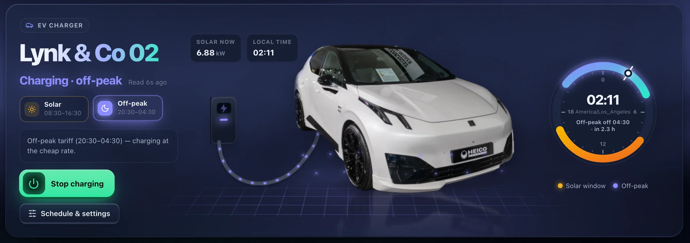
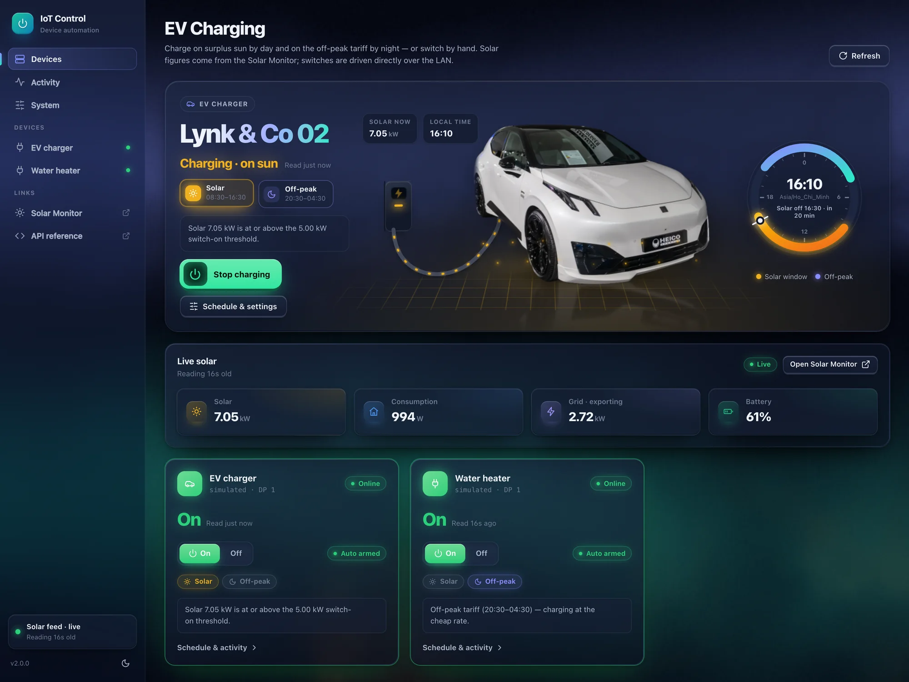
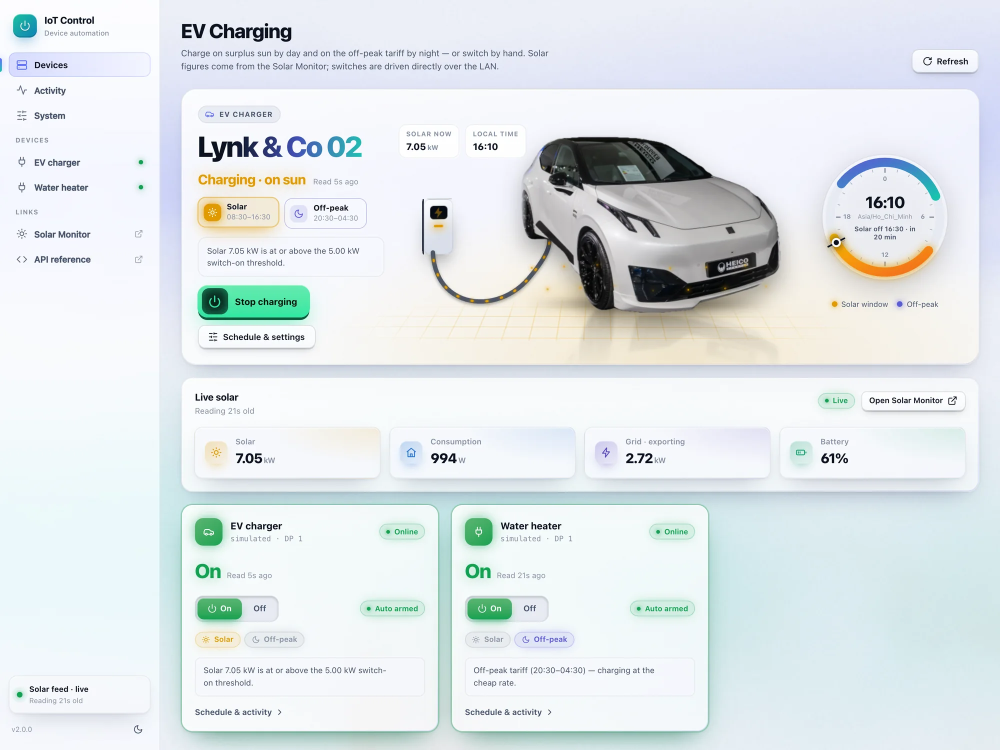
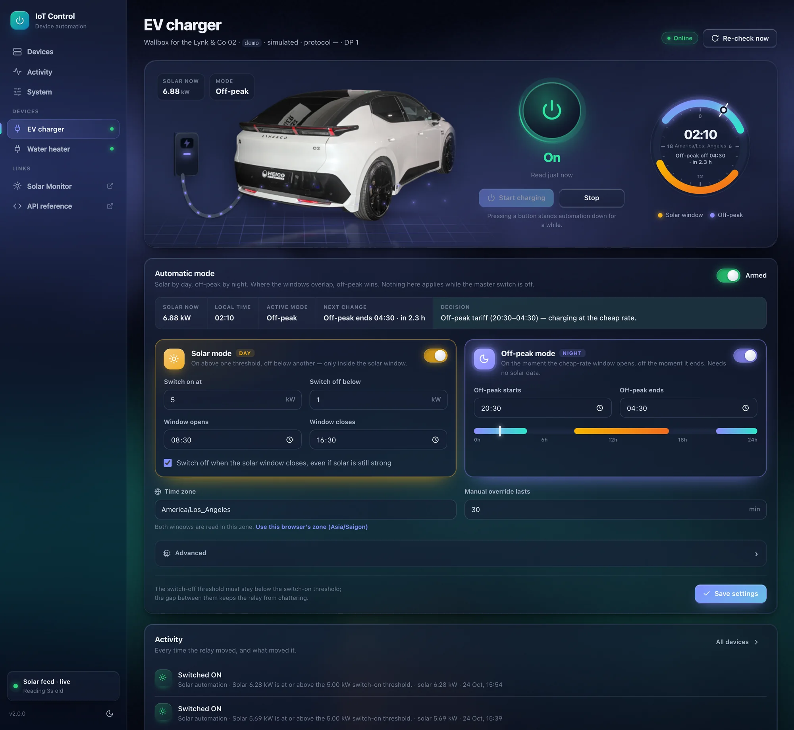
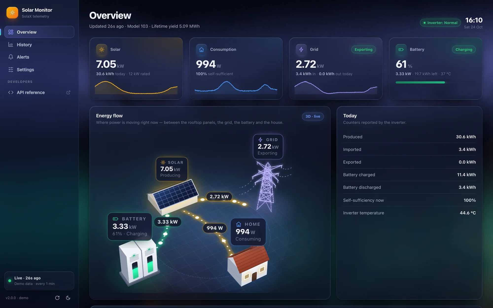
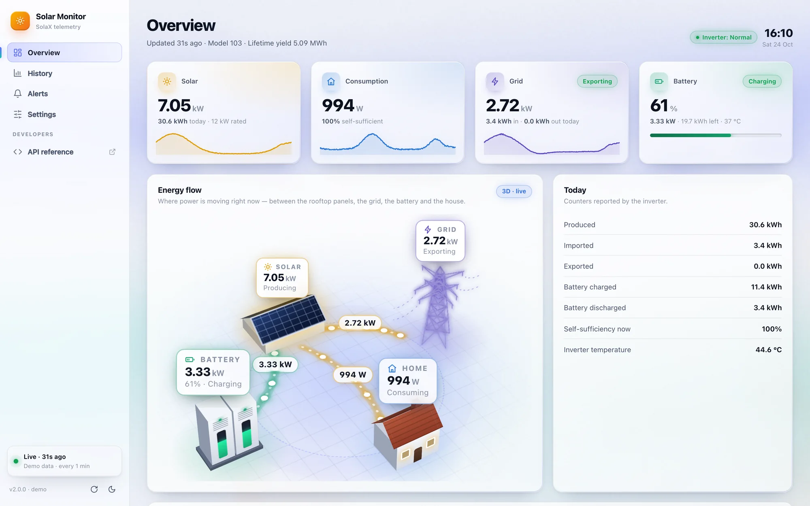
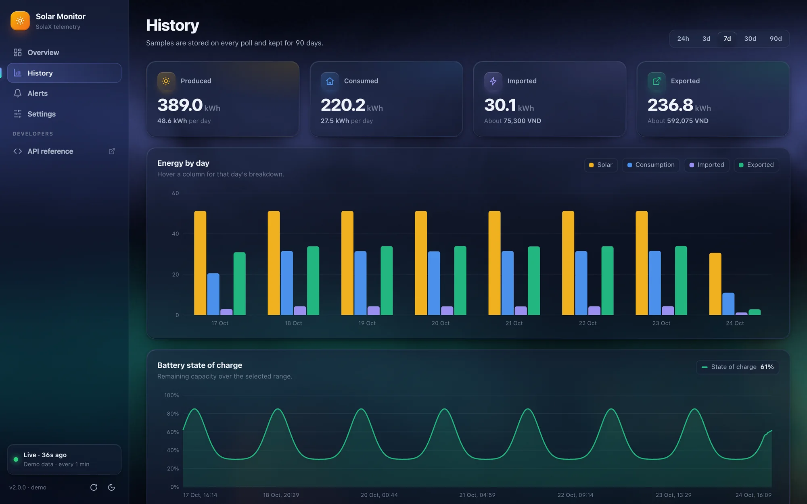
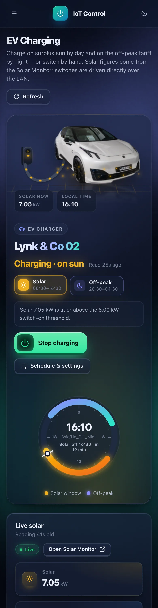

# Solar + IoT



Two small, independent apps for a home solar installation:

| App | Port | What it does |
|---|---|---|
| [`solar-monitor/`](solar-monitor) | 8000 | Polls the SolaX cloud, stores history, raises threshold alerts, and publishes live power figures as a JSON API. |
| [`iot-control/`](iot-control) | 8100 | Drives IoT devices (Tuya relays over the LAN) by hand or automatically, following solar production read **from solar-monitor's API**. |

```
             SolaX Cloud
                  │  OAuth2, 2–3 calls / device / poll
                  ▼
        ┌───────────────────┐  GET /api/v1/power   ┌──────────────────┐
        │   solar-monitor   │ ◀─────────────────── │   iot-control    │
        │ poller · SQLite   │   served from memory │ automation loop  │
        │ alerts · UI :8000 │   (no SolaX quota)   │ SQLite · UI :8100│
        └───────────────────┘                      └────────┬─────────┘
                                                            │ Tuya LAN protocol
                                                            ▼
                                                     relays / sockets
```

The only coupling is the HTTP contract `GET /api/v1/power` (see
[solar-monitor/README.md](solar-monitor/README.md#public-api)). Each app has its
own `.env`, database, Dockerfile and README, and can run, restart or be replaced
on its own. If solar-monitor is down, iot-control treats the missing data as a
reason to switch automated devices **off**.

## Screenshots

| IoT Control — charging on surplus sun | IoT Control — light theme |
|---|---|
|  |  |
| **Charger detail — off-peak mode at night** | **Solar Monitor — 3D energy flow** |
|  |  |
| **Solar Monitor — light theme** | **Solar Monitor — history** |
|  |  |

<p align="center"></p>

- **IoT Control** drives the EV charger relay: a 3D charging bay (car on a lit
  floor, wall box, cable with energy streaming while it charges), a 24-hour
  dial of the solar and off-peak windows, and per-device automation —
  **solar mode** by day, **off-peak mode** by night, in a selectable time zone.
- **Solar Monitor** shows live power as a 3D scene — solar panels on a roof, a
  high-voltage pylon for the grid, a battery cabinet whose gauge is the state
  of charge, the house with its windows lit by the load, and energy streaming
  along the tracks between them — plus charts, history and alerts.

Screenshots come from both apps in demo mode (`DEMO_MODE=true` for the
monitor, `"kind": "demo_switch"` devices for IoT Control).

## Quick start (local)

```bash
# 1. Solar monitor
cd solar-monitor
python -m venv .venv && .venv/bin/pip install -r requirements.txt
cp .env.example .env                      # SolaX credentials, or DEMO_MODE=true
.venv/bin/uvicorn app.main:app --port 8000

# 2. IoT control (second terminal)
cd iot-control
python -m venv .venv && .venv/bin/pip install -r requirements.txt
cp .env.example .env                      # SOLAR_API_URL=http://localhost:8000
cp devices.example.json devices.json      # Tuya id / ip / local key per device
.venv/bin/uvicorn app.main:app --port 8100
```

## Docker

```bash
docker compose up -d --build
# first run only: hand the device inventory to iot-control
docker compose cp iot-control/devices.json iot-control:/app/data/devices.json
docker compose restart iot-control
```

Open http://localhost:8000 (Solar Monitor) and http://localhost:8100 (IoT Control).

`docker-compose.yml` wires iot-control to `http://solar-monitor:8000` on the
compose network. The device inventory lives in the `iot-data` volume rather than
a bind mount (Docker Desktop cannot mount files from every drive); repeat the
`cp` + `restart` after editing it. Tuya control only needs outbound TCP from the
container to the device's LAN address, which the default bridge network allows.

> **One connection per Tuya device.** These switches accept a single local
> session, so do not run a dev server and the container against the same device
> at the same time — both will report it unreachable.

## Design system

Both UIs share one design system — `static/css/base.css`, `static/js/core.js`,
`static/js/fx.js` and the icon sprite in `templates/partials/` — copied into
each app so they stay independently deployable. Keep the copies identical;
app-specific styling lives in `monitor.css` / `control.css`.

"Aurora glass": translucent layers over a WebGL2 aurora, with real depth. Still
no build step and no CDN — only platform features:

| Where | What |
|---|---|
| Background | WebGL2 fragment shader (domain-warped noise), rendered at ⅓ resolution, ~30 fps, paused in hidden tabs; static gradients without WebGL |
| Depth | CSS 3D transforms (`preserve-3d`, `perspective`) for the charging bay, the energy-flow models (built face by face: boxes, gable roofs, a crossed-plane pylon) and pointer-driven card tilt |
| Motion | `@property`-registered angles so tilt and sway transition smoothly; `linear()` spring easing; `animateMotion` energy packets; scroll-driven animation (`animation-timeline: view()`) on the hero car |
| Navigation | Cross-document View Transitions (`@view-transition`) between pages, `startViewTransition` when a relay switches |
| Layout | Cascade layers, container queries, `:has()`, `sibling-index()` stagger, animated `<details>` (`::details-content`, `interpolate-size`) |
| Inputs | `Intl.supportedValuesOf('timeZone')` for the time-zone picker |

Every effect is decorative and drops out under `prefers-reduced-motion`; the
pages stay fully usable without WebGL, 3D transforms or JavaScript animation.

## Credits

The car in IoT Control is a white 2025 Lynk & Co 02 (Heico Sportiv, Auto
Zürich 2025), from photos on Wikimedia Commons by
[Matti Blume](https://commons.wikimedia.org/wiki/User:MB-one)
([front](https://commons.wikimedia.org/wiki/File:Auto_2025,_Zurich_(20251029-P1074285).jpg))
and [Alexander Migl](https://commons.wikimedia.org/wiki/User:Alexander-93)
([rear](https://commons.wikimedia.org/wiki/File:2025_Lynk_%26_Co_02_Heico_Sportiv_Auto_Zuerich_2025_DSC_3612.jpg)),
both licensed [CC BY-SA 4.0](https://creativecommons.org/licenses/by-sa/4.0/).
The cut-outs in `iot-control/app/static/img/` (background removed, resized)
are shared under the same licence. Lynk & Co is a trademark of its owner; this
project is not affiliated with it.
